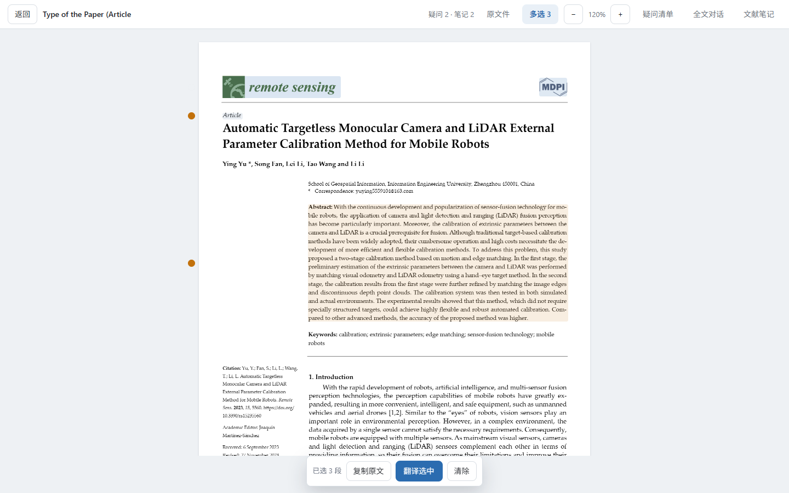
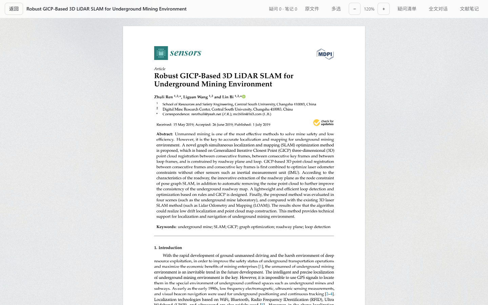
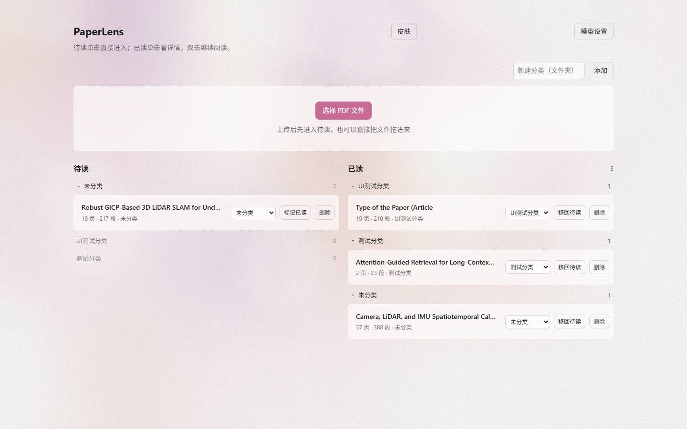
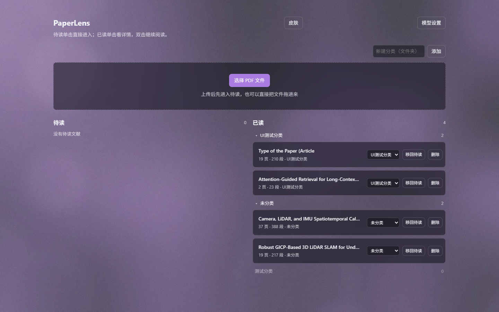
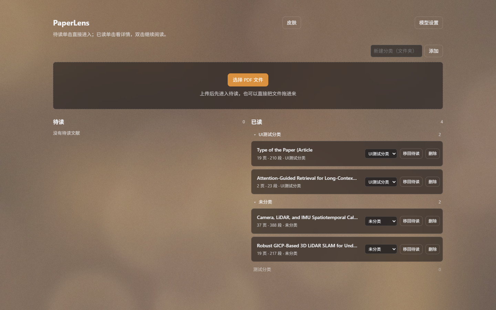

# PaperLens


## 界面效果

| 文献库 | 论文详情 |
|---|---|
|  |  |

| 公式原图 | 表格原图 |
|---|---|
|  |  |

连续多选：



## 换肤效果

皮肤是「一张壁纸 + 一组玻璃参数」：工具栏、卡片、气泡浮在图上，PDF 仍是白纸。
下面四张分别是墨蓝夜航、暖粉梦境、紫罗兰夜、琥珀黄昏；最后一张是换肤抽屉，
可以挑内置皮肤、上传自己的图、单独换主色，并调玻璃模糊与面板不透明度。

| 墨蓝夜航 | 暖粉梦境 |
|---|---|
|  |  |

| 紫罗兰夜 | 琥珀黄昏 |
|---|---|
|  |  |


## 这个项目能做什么
把一份 PDF 论文放进来，它会按段落切开，公式和图表单独识别。点论文里的任意一段，
旁边就会弹出一个气泡：
气泡里可以直接看这段的中文翻译，可以基于整篇或本段提问并拿到带页码出处的回答，
还可以让它按你的提问整理成一段阅读笔记。

公式和图表在气泡里直接显示原图。这两类内容从 PDF 里抽文字本来就抽不准，
与其给你看错位的符号，不如把原页面那一小块裁出来。正文里夹着的行内公式也会
单独裁成原式，跟着文字一起排版，不显示抽取后的乱码。
表格同样按整张原图显示，避免单元格、列头被拆散后翻译错位。
论文页直接按原 PDF 页绘制，至少 2 倍像素密度；行末被连字符拆开的英文单词会自动还原；
编号列表的每一项单独成块，不会和下一项粘在一起；
按住 Shift 点段落或用工具栏的「多选」，可以连续选择多段后复制原文或批量翻译。
图表包含三种形态：嵌入的图片、矢量画的流程图和热力图、用格线画的表格。

页边不留没意义的痕迹：读过的段落不标，只有你问过问题或写过笔记的段落才在页边留一个点，
一眼就能扫到「我当时在哪卡住了」；问过问题的段落正文会保留很轻的暖色底色。右侧的疑问清单
把这些点列成一张表，点一下跳回原文。回答里不出现引用编号和来源角标：只报序号或页码的出处
指不准原文，摆一排反而干扰阅读，所以结论直接写干净；旧库里留下的 `[1]`、`[p1]` 在显示时
一并清掉。
笔记默认在关掉气泡时自动整理，不想要可以在气泡头部关掉；配置页提供标准阅读笔记、
方法贡献拆解、疑问结论清单和自定义模板四种方案。
所有翻译、对话和笔记都存下来，关掉浏览器再打开，点回原来的段落，内容还在。

文献库左边「待读」、右边「已读」。待读的文献单击直接进阅读器；已读的单击弹出论文详情，
一眼看清梗概、方法、解决的问题、结论和自己的疑问与解答，双击才继续读原文。分类在两栏里
当文件夹用：自己新建分类，用文献那一行的下拉把它放进去；每个文件夹都能收起来，
收起的状态记在本机，下次打开还是那个样子。

配置页里还有一份 `agent.md`：用 Markdown 写你希望助手遵守的身份、回答风格和关注重点，
保存后每次问答和整理笔记都会带上它。

界面可以换肤，走的是「一张图一种氛围」：文献库右上角的「皮肤」里挑一张壁纸，工具栏、
卡片、气泡、弹窗立刻变成半透明的玻璃浮在图上，PDF 仍然是白纸、正文照样清楚。内置七套
（暖粉梦境 / 墨蓝夜航 / 素纸 / 苔原绿 / 琥珀黄昏 / 紫罗兰夜 / 石墨），也可以直接丢一张
自己的图进去——主色和明暗从图里算，不用手填色号。主色还能单独换：图里取出来的那几档、
一排常用色（朱砂 / 琥珀 / 苔绿 / 松青 / 海蓝 / 靛蓝 / 紫罗兰 / 玫红 / 石墨），
或者用取色器挑任意颜色。玻璃模糊、面板不透明度、壁纸压暗、阅读台面都能拖滑块调，
点「原味」一键回到默认。

## 技术架构
| 部分 | 用了什么 | 干什么 |
|---|---|---|
| 前端 | React + TypeScript + Vite | 界面、气泡定位、阅读状态 |
| PDF 渲染 | PDF.js | 把 PDF 画到 canvas 上；气泡里的公式和图表另外按高清页面重画 |
| 后端 | FastAPI | 提供接口，托管打包好的前端 |
| 解析 | PyMuPDF + pdfplumber + wordninja + XY-cut | 按行重组段落、还原断词、认列表与公式图表，表格整张按图片处理 |
| 问答 | 本地关键词检索 + 大模型 | 全文检索取最相关的段落，编号后交给模型作答 |
| 存储 | SQLite | 段落、翻译、笔记、对话、文献笔记 |
| 模型接入 | OpenAI 兼容接口 | 对话模型负责问答和笔记，翻译模型只负责翻译；可选 `data/agent.md` 追加个性化设定 |
| 皮肤 | CSS 变量 + 壁纸 + Pillow | 一套皮肤 = 一张壁纸 + 一组玻璃参数；明暗和主色从图里算，界面只改 CSS 变量 |

## 本地运行
```powershell
# 1. 依赖（虚拟环境已经建好，重装时执行）
.\.venv\Scripts\python.exe -m pip install -r backend\requirements.txt

# 2. 首次启动后打开页面，在配置页填写对话模型和翻译模型
#    也可以手动复制 .env.example 为 .env

# 3. 生成一份样例论文（可选）
.\.venv\Scripts\python.exe backend\tests\make_sample.py

# 3b. 重新生成三张内置皮肤壁纸（可选，改了画法才需要）
.\.venv\Scripts\python.exe backend\tests\make_builtin_skins.py

# 4. 启动
.\.venv\Scripts\python.exe -m uvicorn app.main:app --host 127.0.0.1 --port 8756 --app-dir backend
```
浏览器打开 http://127.0.0.1:8756 即可。前端只有改动源码时才需要重新打包：
```powershell
cd frontend
npm install      # 首次
npm run build    # 产出 frontend/dist，后端会自动托管
npm run dev      # 开发模式，5173 端口，接口自动代理到 8756
```

## 部署
不需要单独部署前端。跑 `npm run build` 后，后端一个进程就能同时提供接口和界面：
```powershell
.\.venv\Scripts\python.exe -m uvicorn app.main:app --host 127.0.0.1 --port 8756 --app-dir backend
```
数据都在 `data/` 目录（`library.db` 和上传的 PDF），备份这个目录即可。

接口没有登录鉴权，只适合自己本机用。默认绑 `127.0.0.1` 就只有本机能访问；
如果改成 `0.0.0.0` 让局域网访问，同一网络里任何人都能读、删、上传你的文献，
还能间接消耗你的模型额度。真要多机用，先加一层带 token 的鉴权再绑外网地址。

## 测试
```powershell
# 解析器自检：分栏阅读顺序、坐标范围、主键稳定性、页眉剔除、乱码剔除
.\.venv\Scripts\python.exe backend\tests\test_parser.py

# 检索层自检：超长段落不会把上下文挤空
.\.venv\Scripts\python.exe backend\tests\test_rag.py

# 模型链路自检：用测试专用的假模型服务跑通翻译、问答、整理笔记，不需要 API key
.\.venv\Scripts\python.exe backend\tests\test_llm_flow.py

# 接口冒烟测试：需要服务已在 8756 运行
# 会往库里放一份测试样张，跑完自动把它恢复成进来时的状态
.\.venv\Scripts\python.exe backend\tests\smoke_api.py

# 前端类型检查与打包
cd frontend; npm run build

# 界面渲染检查：用本机 Edge 打开应用，验证待读/已读两栏、分类、详情弹窗、
# 锚点、气泡、公式与插图原图、行内公式、引用标记清掉
# 需要后端已在 8756 运行
# 如果服务还没有模型配置，可用临时 ENV_FILE + SKIP_CONNECTION_TEST=1，
# 并设置 VERIFY_SETUP_CONFIG=1，让测试先走配置页再进入文献库
# 提问那一步会真的调用对话模型，接真实厂商时等一分钟以上是正常的
cd frontend; node scripts/verify_ui.mjs
```

五套检查合计一百多项断言：解析、检索、模型链路和接口冒烟都在本地跑完，不需要真实厂商；
界面渲染检查会真的开一次浏览器，服务已经配好模型时，提问那一步会真实调用一次对话模型。

## 搜索记录
开工前在 GitHub 上查过一轮同类项目，结论如下，避免重复调研：

| 项目 | 结论 |
|---|---|
| Future-House/paper-qa | 科研文档 RAG 问答，带引用。本项目没有直接依赖它，只借鉴了「答案必须标出处」的做法 |
| PDFMathTranslate | 保留排版的整篇双语翻译。做的是整篇重排，不保留逐段阅读状态，与本项目不冲突 |
| windingwind/zotero-pdf-translate | Zotero 划词翻译插件，成熟。本项目是独立阅读器，不依赖 Zotero |
| MuiseDestiny/zotero-gpt | Zotero 内与论文对话，同样绑定 Zotero |
| steven-jianhao-li/zotero-AI-Butler | 自动精读整库生成笔记，偏批处理，不做逐段交互 |
| TideDra/zotero-arxiv-daily | 按已有文献库每日推荐 arXiv 新文，属于「找论文」环节 |

结论：翻译和问答已有成熟方案，本项目的差异点是「以段落为单位、把翻译、提问、结论绑在一起长期保留」，
所以自建的是锚点系统、气泡定位和阅读状态存储这三块。

### 皮肤功能调研
要做的不是几套主题色，而是 codex-dream-skin 那种「一张图一种氛围」的换肤。2026-10-22 在 GitHub 查到的参考：

| 项目 | 结论 |
|---|---|
| Fei-Away/Codex-Dream-Skin | 事实源头。用本地 CDP 注入 CSS，把界面换成壁纸 + 半透明面板，原生控件照常可用；一套主题就是「一张图 + 一组参数」，社区出图在 dreamskin.cc |
| codex-dream-skin/codex-dream-skin | 同一路子，强调可逆、不动安装包；只改背景和面板，交互仍是原生的 |
| aithink001/Codex-Dream-Skin-Themes | 把换肤做成 Skill：自定义 Banner、安装 / 切换 / 实时验证 / 一键恢复 |
| moonlin1213/codex-dream-skin-studio-skill | 从一张参考图生成整套皮肤，等于「输入图 → 输出皮肤包」 |
| Finderchangchang/codex-autoskin | 发一张图就自动换肤，同样是图驱动 |

结论：皮肤的单位不是色板，而是「皮肤包」= 背景图 + 面板玻璃参数 + 从图里派生的语义色。
PaperLens 是网页应用，不用 CDP 注入，直接改 CSS 变量和 `<html>` 上的内联样式就能做到，
可逆性是天然的。

## 已完成
- [x] 上传 PDF，解析成带归一化坐标的段落
- [x] 按行重组段落，行内公式不再把一句话切成七八个碎片
- [x] 识别公式块与图表区域（嵌入图片、矢量流程图、格线表格），界面上按原图显示
- [x] 识别带 `Table N` 标题的数据表，整张裁成表格原图，单元格不再拆成独立块
- [x] 双栏阅读顺序（XY-cut）
- [x] 剔除重复页眉页脚、剔除字体映射失败的乱码块
- [x] PDF 连续渲染，滚动到附近才绘制，缩放时重绘
- [x] 页边锚点，左右栏分别落在最近的页边距；不再画蓝色引线
- [x] 只在问过问题或写过笔记的段落留常驻锚点，其余鼠标移上去才浮现
- [x] 浮动气泡，三档避让定位（右→左→下→上，兜底钉右侧）
- [x] 翻译、对话（全文 / 本段切换）、笔记三个页签，公式与图表可看原图
- [x] 行内公式按原页面高分辨率裁图，在正文里原地显示成公式符号
- [x] 气泡里的公式与图表按至少 2 倍像素密度重绘，不为了塞进气泡而压小
- [x] 主页面至少 2 倍像素密度渲染，离开视口后释放画布控制内存
- [x] 通用还原 PDF 行末断词，例如 `simula-` + `tion` 拼成 `simulation`，`state-` + `of-the-art` 保留连字符
- [x] 编号/项目符号列表按项分块，续行留在本项，不跨到下一项
- [x] Shift 连续多选段落，支持复制原文和批量翻译
- [x] 疑问清单：把留过痕迹的段落列成一张表，点一下跳回原文
- [x] 关窗时自动整理笔记（可关）
- [x] 全文对话面板与整篇文献笔记
- [x] 回答里不显示引用编号和来源角标，直接给结论
- [x] 旧回答里残留的 `[1]`、`[p1]` 显示时自动清掉，`[2024]` 这类年份不受影响
- [x] 问过问题的段落在 PDF 上保留暖色标注，页边留下疑问点
- [x] 支持标准、方法拆解、疑问清单和自定义四种笔记模板
- [x] 文献库分「待读」「已读」两栏，待读单击直接进入
- [x] 已读单击看论文详情，双击继续阅读
- [x] 分类在两栏里当文件夹用，可新建、逐篇归类、收起，收起状态记在本机
- [x] 配置页可编辑 `agent.md`，自定义助手身份与回答风格
- [x] 皮肤：一张壁纸 + 玻璃面板，内置七套（含暖粉 / 墨蓝 / 素纸 / 苔绿 / 琥珀 / 紫罗兰 / 石墨）
- [x] 可上传自己的图当皮肤，明暗和主色从图里算，也能在界面上手动钉住
- [x] 主色可单独换：图里取的色、九个常用色，或自己取任意颜色
- [x] 玻璃模糊、面板不透明度、壁纸压暗、阅读台面可调，点「原味」一键还原
- [x] 皮肤跟随 `data/` 一起备份，首屏不会闪一下默认配色
- [x] 产品统一改名为 PaperLens
- [x] 一键把整篇的阅读记录导出成 Markdown（笔记 + 疑问 + 完整问答）
- [x] 首次进入先显示模型配置页，保存前测试连接，配置完成后才进入文献库
- [x] 配置只保留对话模型和翻译模型；全文问答用本地关键词检索，不需要向量模型
- [x] 已配置后可随时从文献库的「模型设置」返回修改
- [x] 配置页可以直接从服务端 `/models` 拉取模型名；API Key 输入不触发密码管理器

## 待办
- [ ] 在真实 API 上验证翻译与问答（链路已用假模型验过，还差真实厂商的兼容性）
- [ ] 扫描件 OCR 接入
- [ ] 用视觉模型读公式和插图（现在只能靠原图给人看）

