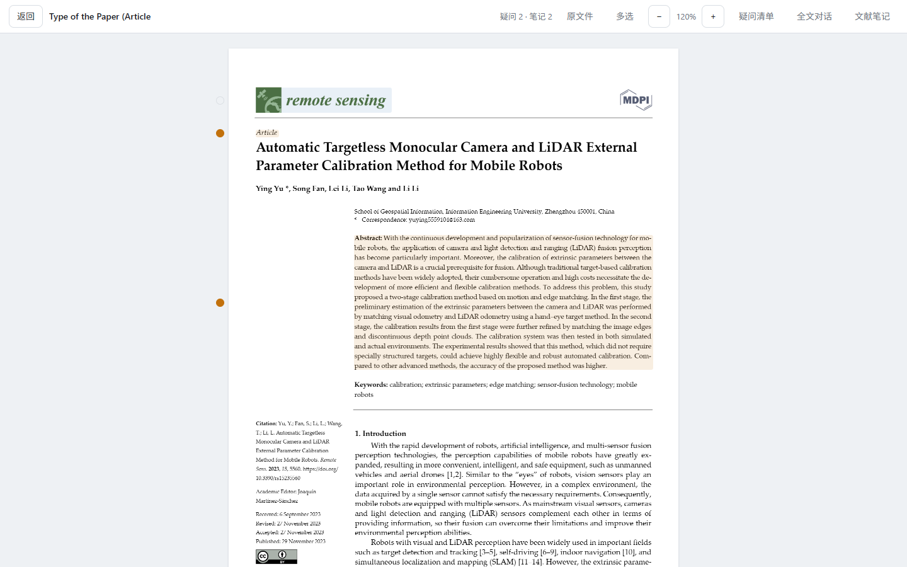
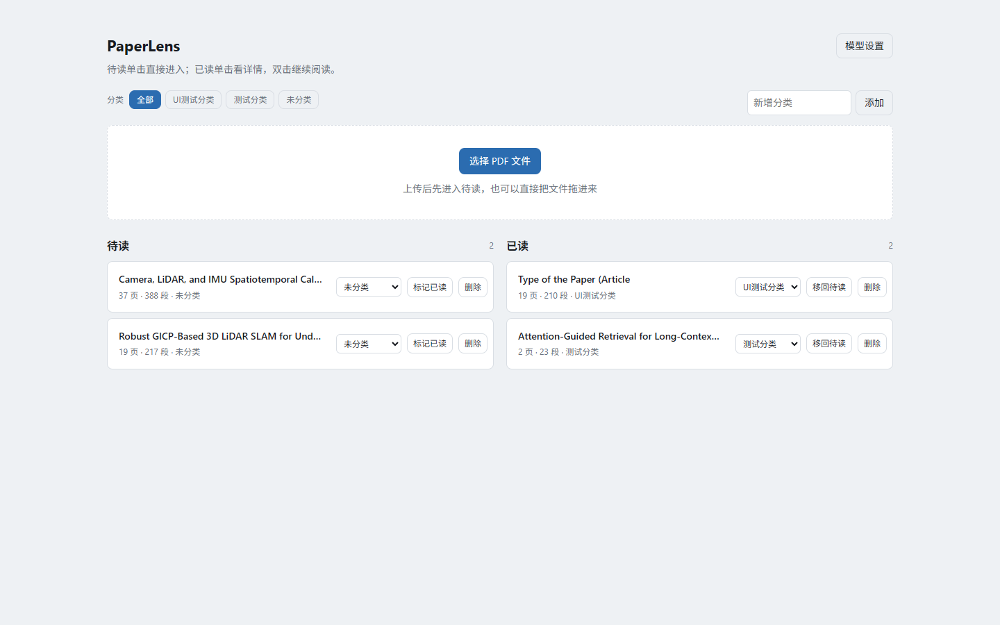
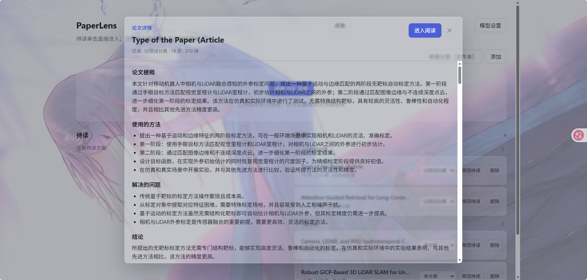
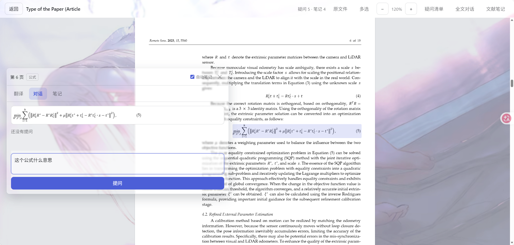
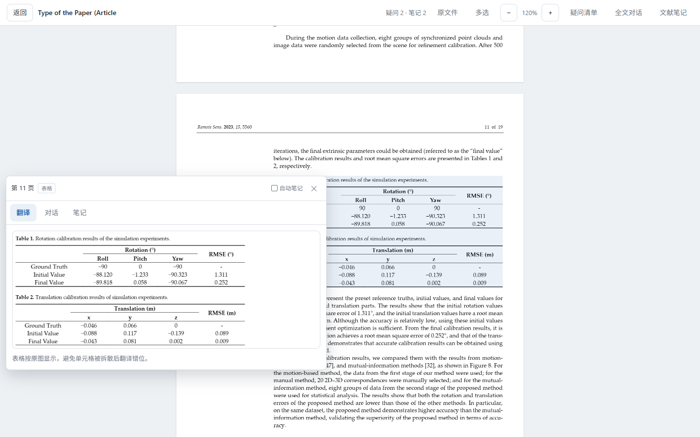
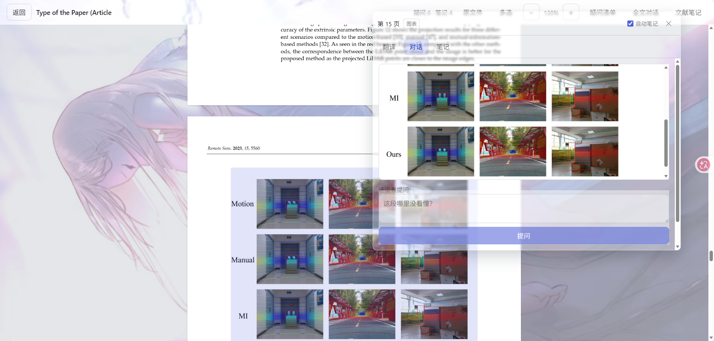
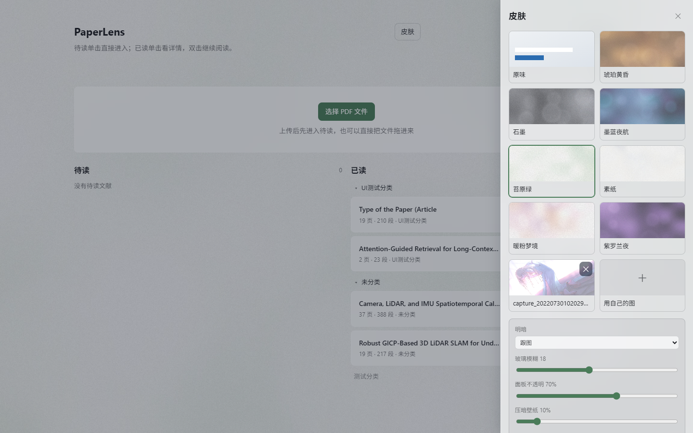
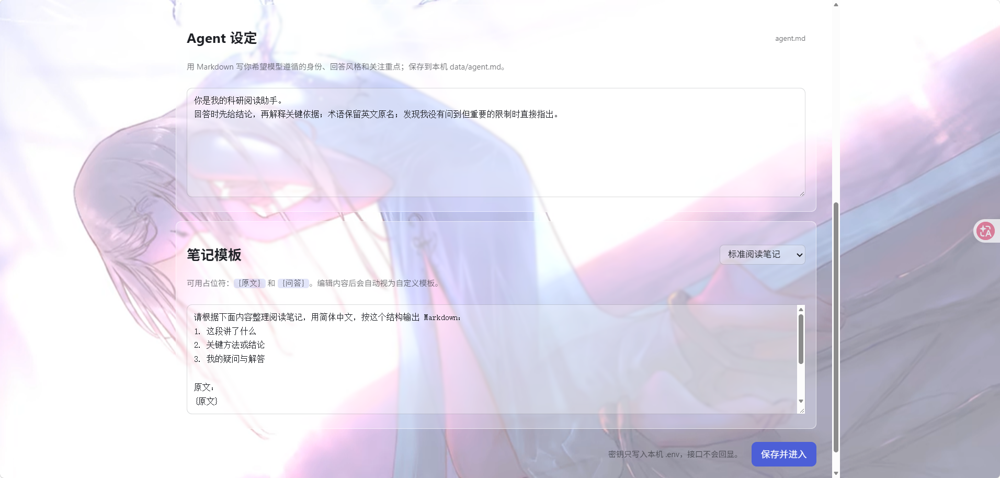

<div align="center">

# PaperLens

**以段落为单位的 PDF 论文阅读器。**
逐段翻译、AI 问答、阅读笔记，全都锚在原文的那一段上；界面还能整张壁纸换肤。

[](https://www.python.org/)
[](https://fastapi.tiangolo.com/)
[](https://react.dev/)
[](https://www.typescriptlang.org/)
[](LICENSE)

[中文说明](README.zh-CN.md) &nbsp;|&nbsp; [English](README.md)

</div>



## 这是什么

读一篇长论文很少是线性的：你在一个定义、依赖它的方法、以及验证它的实验之间来回跳。
现有工具大多把论文摊平成一长条文字，读过哪里、卡在哪里、当时问了什么，全留不下痕迹。

PaperLens 把论文按段落切块，让每个段落都成为一个可以长期停留的位置。点任意一段，
旁边弹出气泡：看这一段的中文翻译、就这一段向助手提问（助手拿整篇当依据）、或者让它把
这一段整理成阅读笔记。所有内容都绑在这一段上存进本地库，关掉浏览器再打开还在。

## 效果预览

文献库分「待读 / 已读」两栏，分类当文件夹用；已读的单击看详情，双击继续读原文。

| 文献库 | 论文详情 |
|---|---|
|  |  |

### 问答效果

问到公式时，气泡里先把那一块的原图摆出来，再回答：



问到表格时，表头和数字一起显示，助手直接按表格讲指标：



问到插图时，原图连同问题一起交给看图模型：



### 换肤与设置

一套皮肤 = 一张壁纸 + 一组玻璃参数。工具栏、卡片、气泡、弹窗变成半透明玻璃浮在图上，
PDF 仍然是白纸、正文照样清楚。可以上传自己的图，明暗和主色从图里算，也能单独换主色。



模型设置页：除了两组模型接口，还能写 `agent.md`（助手身份与回答风格）和笔记模板。



## 功能

**阅读与解析**

- 上传 PDF，按段落切成带坐标的块，解析结果可跨次上传复用
- 双栏阅读顺序（XY-cut），剔除重复页眉页脚和乱码块
- 行末断词自动还原：`simula-` + `tion` → `simulation`，`state-` + `of-the-art` 保留连字符
- 编号和项目符号列表按项分块，续行不会跑到下一项
- 识别公式块、嵌入图片、矢量图表和带 `Table N` 标题的数据表
- 主页面至少 2 倍像素密度渲染，离开视口后释放画布

**逐段问答与笔记**

- 点任意一段提问：助手拿整篇当依据，同时一定带上你点的那一段
- 问图、问公式、问表格时，那一块的原图会一起发给支持看图的对话模型（配置页可关）
- 提问先把问题显示出来，答案边生成边显示（SSE 流式）
- 回答里的数学公式用 KaTeX 排版，Markdown 的列表和粗体正常显示
- 气泡按住标题栏可拖动，拖过之后不跟着段落跑
- 四种笔记模板：标准阅读笔记、方法贡献拆解、疑问结论清单、自定义
- 关掉气泡时可按需自动整理笔记
- 一键把整篇阅读记录导出成 Markdown（笔记 + 疑问 + 完整问答）

**文献库**

- 左「待读」右「已读」两栏，待读单击直接进阅读器，已读单击看详情、双击继续读
- 分类在两栏里当文件夹用，可新建、逐篇归类、收起，收起状态记在本机
- 论文详情按需生成并缓存：梗概、方法、解决的问题、结论 + 自己的问答

**外观**

- 内置七套皮肤：暖粉梦境 / 墨蓝夜航 / 素纸 / 苔原绿 / 琥珀黄昏 / 紫罗兰夜 / 石墨
- 可以上传自己的图当皮肤，明暗和主色从图里算
- 主色可单独换：图片取色 + 九个常用色 + 任意取色器
- 玻璃模糊、面板不透明度、壁纸压暗、阅读台面都能拖滑块调，一键还原
- 皮肤跟随 `data/` 一起备份，首屏不闪默认配色

## 快速开始

### 1. 准备环境

需要 Python 3.11+ 和 Node.js 18+。

```powershell
git clone https://github.com/ZaraSheven/PaperLens.git
cd PaperLens

python -m venv .venv
.\.venv\Scripts\python.exe -m pip install -r backend\requirements.txt

cd frontend
npm install
npm run build
cd ..
```

### 2. 启动

```powershell
.\.venv\Scripts\python.exe -m uvicorn app.main:app --host 127.0.0.1 --port 8756 --app-dir backend
```

浏览器打开 <http://127.0.0.1:8756>。

首次进入是模型配置页，填两组 OpenAI 兼容接口即可，保存后自动写入 `.env`：

| 配置项 | 用途 |
|---|---|
| 对话模型 | 问答、论文详情、整理笔记，可勾选「支持看图」 |
| 翻译模型 | 只负责逐段翻译，和对话模型相互独立 |

也可以手动 `copy .env.example .env` 后填写。界面可以直接从服务端 `/models` 拉取模型名。

### 3. 可选：生成一份样例论文

```powershell
.\.venv\Scripts\python.exe backend\tests\make_sample.py
```

输出在 `samples/sample-paper.pdf`，一份双栏排版的合成论文，用来快速试功能。

## 技术栈

| 部分 | 用了什么 | 干什么 |
|---|---|---|
| 前端 | React + TypeScript + Vite | 界面、气泡定位、阅读状态 |
| PDF 渲染 | PDF.js | 把 PDF 画到 canvas；公式和图表按高清页面重画 |
| 后端 | FastAPI | 提供接口，托管打包好的前端 |
| 解析 | PyMuPDF + pdfplumber + wordninja + XY-cut | 段落重组、断词还原、公式图表识别 |
| 问答 | 本地关键词检索 + 大模型 | 锚点段落优先，全篇关键词命中补充 |
| 存储 | SQLite | 段落、翻译、笔记、对话、文献笔记 |
| 模型接入 | OpenAI 兼容接口 | 对话模型负责问答和笔记，翻译模型只管翻译 |
| 公式渲染 | react-markdown + KaTeX | 回答里的 `$...$` 排成数学公式 |
| 皮肤 | CSS 变量 + 壁纸 + Pillow | 从图里算明暗和主色，只改 CSS 变量 |

## 目录结构

```
PaperLens/
├─ backend/
│  ├─ app/              接口、解析、检索、模型调用、皮肤、SQLite
│  │  └─ skins/         内置皮肤（壁纸 + 参数）
│  └─ tests/            自检脚本和测试用假模型
├─ frontend/
│  ├─ src/              React 界面、气泡、PDF 渲染、皮肤
│  └─ scripts/          界面渲染检查
├─ docs/screenshots/    展示用界面效果图
├─ data/                运行时数据（数据库、上传的 PDF、皮肤缓存），不进仓库
├─ ARCHITECTURE.md      模块职责与关键设计决定
└─ CONTEXT.md           当前进度
```

## 数据与备份

运行时数据都在 `data/`：`library.db`、上传的 PDF、你自己的皮肤、`agent.md`。
备份直接复制这个目录即可。

服务默认只绑 `127.0.0.1`，接口没有登录鉴权。如果改成 `0.0.0.0` 让局域网访问，
同一网络里任何人都能读、删、上传你的文献，还能消耗你的模型额度；要多机用请先自己加一层鉴权。

## 测试

<details>
<summary>展开测试命令</summary>

```powershell
# 解析器自检：分栏顺序、坐标范围、主键稳定性、页眉剔除、乱码剔除
.\.venv\Scripts\python.exe backend\tests\test_parser.py

# 检索层自检：上下文拼装、类型标记、空图块不丢
.\.venv\Scripts\python.exe backend\tests\test_rag.py

# 模型链路自检：用假模型跑通翻译、问答、流式回答、整理笔记，不需要 API key
.\.venv\Scripts\python.exe backend\tests\test_llm_flow.py

# 接口冒烟测试：需要服务已在 8756 运行，跑完会把样张恢复原状
.\.venv\Scripts\python.exe backend\tests\smoke_api.py

# 前端类型检查与打包
cd frontend; npm run build

# 界面渲染检查：用本机 Edge 打开应用，需要后端已在 8756 运行
# 上游模型掉线时，先起一个「假模型 + 临时数据目录」的实例再跑：
#   .venv\Scripts\python.exe backend\tests\serve_fake_app.py --port 8765
#   cd frontend; $env:APP_URL="http://127.0.0.1:8765"; node scripts/verify_ui.mjs
cd frontend; node scripts/verify_ui.mjs
```

后端三项自检加接口冒烟都在本地跑完，不需要真实厂商；界面渲染检查会真的开一次浏览器。

</details>

## 接口一览

<details>
<summary>展开主要接口</summary>

| 方法 | 路径 | 作用 |
|---|---|---|
| GET / PUT | `/api/config` | 读取或保存对话与翻译模型配置 |
| POST | `/api/config/models` | 从上游 `/models` 拉取模型名 |
| POST | `/api/documents` | 上传 PDF，同步解析成段落块 |
| GET / PATCH / DELETE | `/api/documents/{id}` | 文献详情、改名归类、删除 |
| GET | `/api/documents/{id}/file` | 原始 PDF |
| GET | `/api/documents/{id}/blocks` | 段落块（含坐标和类型） |
| GET / PATCH | `/api/blocks/{id}` | 单块的翻译和笔记 |
| POST | `/api/blocks/{id}/translate` | 翻译这一段 |
| POST | `/api/blocks/{id}/messages/stream` | 就这一段提问，SSE 流式返回 |
| POST | `/api/documents/{id}/messages/stream` | 整篇对话，SSE 流式返回 |
| POST / PUT | `/api/documents/{id}/note` | 整篇文献笔记 |
| GET | `/api/documents/{id}/markdown` | 导出整篇阅读记录 |
| GET / POST / DELETE | `/api/skins` | 皮肤列表、上传、删除 |
| GET / PUT | `/api/appearance` | 当前皮肤与外观参数 |

</details>

## 开发

<details>
<summary>展开开发说明</summary>

前端开发模式带热更新，接口代理到 8756：

```powershell
cd frontend
npm run dev      # http://127.0.0.1:5173
```

改了前端源码要重新 `npm run build`，后端会托管 `frontend/dist`；改了后端要重启 uvicorn，
两者都不会自动跟着源码走。

详细的模块职责、数据流和关键设计决定见 [ARCHITECTURE.md](ARCHITECTURE.md)。

</details>

## 路线图

- [ ] 扫描件 OCR 接入
- [ ] 整库层面的检索与综述

## 已知限制

- 扫描件需要先 OCR，当前只认带文字层的 PDF。
- 没有嵌入向量：全文检索走本地关键词排序，够用但对措辞差异不敏感。
- 论文详情第一次生成依赖对话模型，可能比普通列表慢。

## 参考与致谢

同类项目调研过一轮，结论记录在 [ARCHITECTURE.md](ARCHITECTURE.md)；本项目不依赖它们。

- [Future-House/paper-qa](https://github.com/Future-House/paper-qa)：答案必须标出处
- [PDFMathTranslate](https://github.com/Byaidu/PDFMathTranslate)：整篇双语翻译
- [windingwind/zotero-pdf-translate](https://github.com/windingwind/zotero-pdf-translate)：Zotero 划词翻译
- 皮肤思路来自 [Codex-Dream-Skin](https://github.com/Fei-Away/Codex-Dream-Skin) 系列

## 许可证

[MIT](LICENSE)